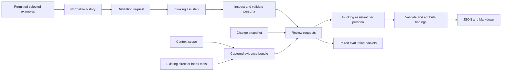

# Architecture of this public reconstruction

The portable CLI is an offline artifact engine, not an unattended model client. The skill supplies the control flow and the current assistant performs inference. Shared Python source powers source-run commands and self-contained skill installations. No indexer, embeddings, provider SDK, account integration, or hidden model call exists.

History normalization separates identifying provenance from inference records, preserves discussion and source IDs, and labels target-role evidence. Distillation requests carry the selected examples and style choice. Versioned PersonaProfile artifacts hold arbitrary principles, applicability, rationale, evidence links, uncertainties and optional general style. Finalization validates the assistant's accepted draft rather than mapping tags to canned personas.

ContextSpec separates scope from retrieval. ContextBundle captures bounded, source-checked evidence and gaps without silently expanding a selected domain. Context and change snapshots enter the same request so later finalization can validate attribution and source references. Digests detect drift; they do not establish truth, origin, permissions or safety.

Reviews are separate attributed tasks. Findings must refer to added lines and known context/principle IDs. Exact file/line/rule duplicates combine while preserving per-reviewer messages and principle attribution. Missing reviewers, rejected findings or collection gaps yield a partial report. Well-formed incorrect findings remain possible. No reviewed application code is executed.

The ablation harness separates reviewer packets from judgments and pairs generic/persona conditions with identical captured inputs. Context removal and optional style removal are separate conditions. An explicit adjudicator can map findings to expected issues with rationale. Without adjudication it reports execution/output completeness, not accuracy. Shared-session examples are not independent experiments.

The earlier deterministic AST implementation remains in baseline.py for regression illustration. It does not power learned personas. This reconstruction does not claim equivalence to the private original system, whose model-provider integrations, implementation history, datasets and operational results remain excluded.
