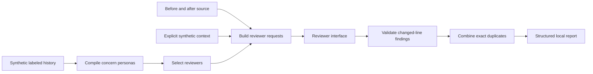

# Architecture of this reconstruction

`compile_personas` maps supported concern labels to independently authored instructions. Synthetic lesson identifiers provide traceability. Lesson prose is not used to infer a person's voice, reproduce opinions, or build instructions. Selection is explicit: all compiled concerns by default, or a caller-supplied subset.

`Change` contains before and after source plus a file label. It never opens a repository file. A standard sequence matcher identifies inserted or replaced after-file lines. Context is an explicit dictionary; this baseline uses `restricted_log_fields`. There is no retrieval store or hidden project context.

Each reviewer receives a `ReviewRequest` containing its persona, source, context, system prompt, and a separate JSON input. This separation is an interface convention, not a proven defense against prompt injection. The local backend parses Python source into a syntax tree and checks only its assigned concern. It does not interpret prompt text or execute code.

The `Reviewer` protocol accepts a request and returns `Finding` objects. A future adapter can implement that interface, but no external model adapter or network transport is included. Such an adapter would require separate privacy, output-validation, reliability, and quality evaluation.

The orchestrator rejects malformed findings and those outside added or replaced lines. Findings with the same file, line, and rule are combined. Reviewer attribution comes from the orchestrator; an adapter cannot invent attribution. The highest reported severity is retained and the first message is preserved. This is exact deduplication, not semantic consensus or evidence of correctness.

Reviewers run sequentially and errors fail explicitly. The reconstruction omits remote review collection, historical persona inference, model calls, parallel scheduling, semantic aggregation, and operational integrations. These choices make the abstraction testable locally; they are not claims about equivalent behavior in the earlier engine.
